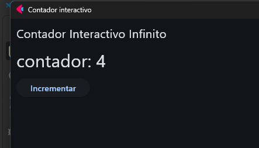

# Taller de Investigacion: Flet Biblioteca de Python

-**Tema:** Interfaces graficas y programacion orientada a eventos.
-**Biblioteca seleccionada:** Flet

# ¿Que es Flet?

Flet es una biblioteca de Python que permite desarrollar interfaces graficas modernas utilizando solamente python, con esta herramienta, es posible crear aplicaciones para escritorio, web y dispositivos moviles, todo esto, sin la necesidad de implementar otros lenguajes de programacion como Html, Css y Js.

El proposito principal de esta biblioteca es facilitar el desarrollo de interfaces graficas interactivas mediante controles visuales y programacion orientada a eventos.

# Tipos de aplicaciones que permite desarrollar flet

- Aplicaciones de escritorio para Windows, macOS y Linux.
- Aplicaciones web.
- Aplicaciones móviles para dispositivos Android e IOS.
- Aplicaciones interactivas.

# Requisistos e Instalacion

**Requisistos:** 
- Python 3.10 o superior.
- Biblioteca Flet versión 1.0.5.

**Instalacion:** esta se instala directamente desde la terminar ejecutando lo siguiente:
```bash
pip install flet
```

# ¿Cuales son sus principales componentes y elementos graficos?

Flet proporciona una gran variedad de componentes graficos llamados controles los cuales permiten construir interfaces de usuario para los diferentes tipos de aplicaciones que permite desarrollar esta biblioteca, entre los mas utilizados estan:

-**text:** sirve para mostrar un texto.
-**Button:** sirve para crear botones interactivos.
-**TextField:** para escribir informacion de usuario.
-**Checkbox:** se emplea para opciones de seleccion.
-**Image:** esta para mostrar imagenes.
-**Row y Column:** sirven para organizar elementos en filas y columnas.
-**Dropdown:** se implementa para listas desplegables.
-**Silder:** sirve para seleccionar valores mediante una barra deslizante.
-**Page:** representa la ventana o lienzo principal de la aplicacion.

# ¿Como maneja los eventos del usuario?

Flet maneja estos eventos mediante un modelo de programacion orientada a eventos, por lo que, cada control grafico puede asociar propiedades como **on_click** , **on_change** u otros eventos, por consiguiente, cuando un usuario interactua con la interfaz por ejemplo, haciendo clic en un boton o cuando modifica un campo de texto flet detecta la accion y ejecuta automaticamente la funcion asociada, por ende, dicha funcion recibe un parametro que contiene la informacion del evento ocurrido y asi permitiendo reponder de manera dinamica a las acciones del usuario y por ultimo actualiza la interfaz que visualiza el usuario cuando sea necesario.

# ¿Que ventajas y limitaciones presenta frente a Tkinter?

| Aspecto | Flet | Tkinter |
|----------|----------|----------|
| Instalacion | Requiere instalar la biblioteca mediante `pip install flet`. | Generalmente viene incluido con Python. |
| Apariencia visual | Interfaces modernas basadas en Flutter. | Apariencia mas tradicional y basica. |
| Plataformas soportadas | Permite desarrollar aplicaciones de escritorio, web y moviles. | Principalmente aplicaciones de escritorio. |
| Componentes graficos | Amplia variedad de controles modernos e interactivos. | Menor cantidad de controles y opciones de diseño. |
| Personalización | Alto nivel de personalizacion visual. | Personalización mas limitada. |
| Dependencias | Necesita instalar paquetes externos. | No requiere dependencias adicionales. |

# Explicacion del funcionamiento

1. **¿Como se crea la ventana o pantalla principal?**
La ventana principal se crea mediante la funcion ft.run(main), cuando flet ejecuta la funcion main, genera la ventana y proporciona el objeto page, que representa la pantalla principal de la aplicacion.

2. **¿Como se crean y muestran los componentes graficos?**
Los componentes graficos se crean mediante controles de flet, como Text y Button, pero estos luego se agregan a la ventana utilizando el metodo page.add().

3. **¿Que evento implemento y como se detecta?**
Se implemento el evento de clic sobre un boton mediante la propiedad on_click, despues flet detecta automaticamente cuando el usuario presiona el boton y ejecuta la accion asociada.

4. **¿Que funcion o metodo responde al evento?**
El metodo incrementar() es el encargado de responder al evento, por lo tanro, este metodo se ejecuta cada vez que el usuario hace clic en el boton Incrementar.

5. **¿Como se modifica la interfaz despues de la interaccion?**
Esta se ejecuta cuando el metodo incrementar(), el valor del contador aumenta en una unidad y se actualiza el texto mostrado en pantalla y finalmente, se utiliza page.update() para refrescar la interfaz y mostrar el nuevo valor.

# Reto adicional POO usando clases y objetos

La aplicacion fue desarrollada utilizando Programacion orientada a objetos mediante la clase ContadorApp, la cual encapsula tanto la logica del contador como los componentes graficos de la interfaz.

-**Atributo de Estado:** self.contador almacena el valor actual del contador y permite llevar el control de cuantas veces se ha presionado el boton.

-**Atributos Visuales:** self.texto_contador mantiene la referencia al componente que muestra el valor del contador en pantalla y self.boton_incrementar representa el botón que permite interactuar con la aplicacion.

-**Metodo construir_interfaz():** tiene la responsabilidad de organizar y mostrar los componentes gráficos dentro de la ventana principal, estableciendo el título y agregando los controles a la página.

-**Metodo incrementar():** este responde al evento generado cuando el usuario hace clic en el botón, por ende, su función es aumentar el valor del contador, actualizar el texto mostrado y refrescar la interfaz grafica.

-**Encapsulamiento:** La clase ContadorApp agrupa todos los atributos y metodos relacionados con el funcionamiento de la aplicacion, manteniendo organizada la logica del programa y facilitando su mantenimiento.

# Evidencia del funcionamiento


# Fuentes consultadas
- https://flet.dev/
- https://www.pythonguis.com/tutorials/getting-started-flet/
- https://pypi.org/project/flet/